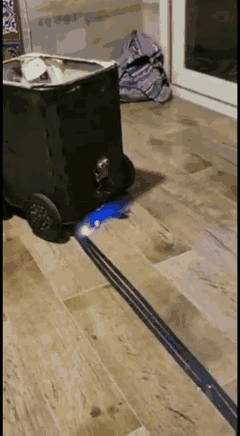
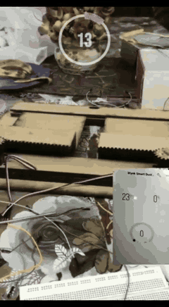
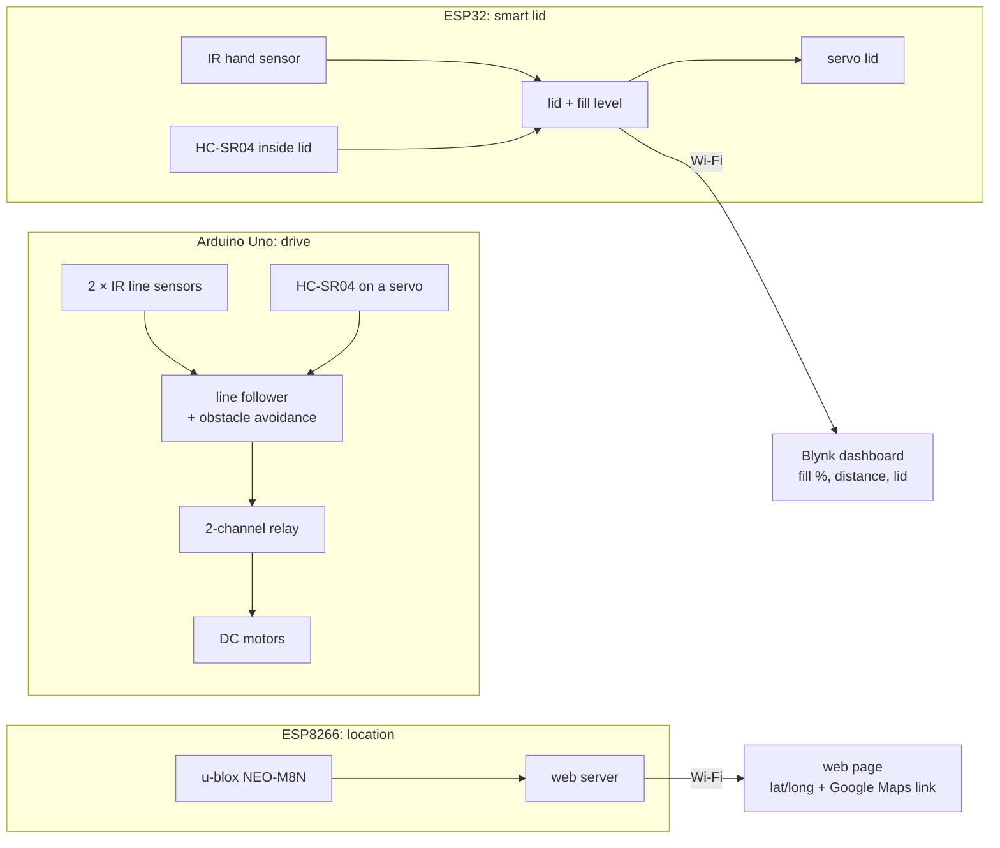
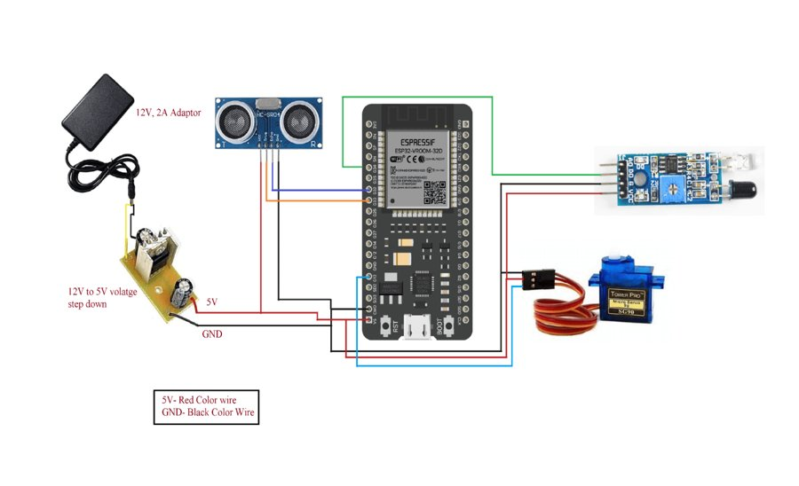
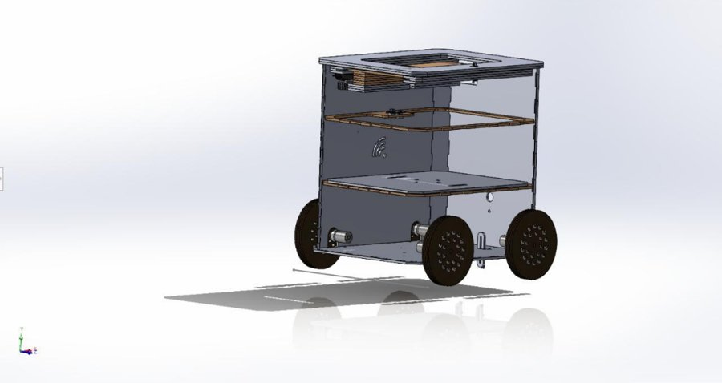
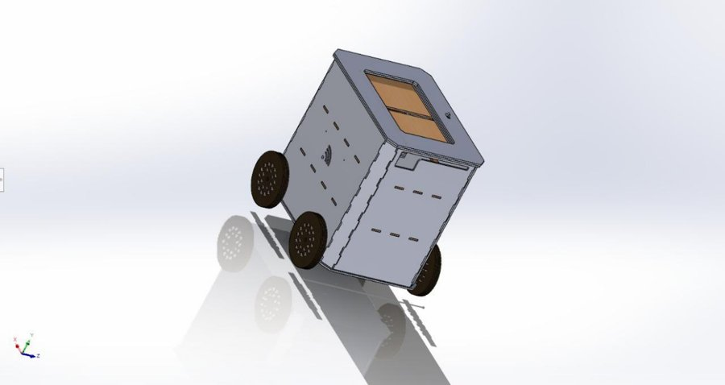
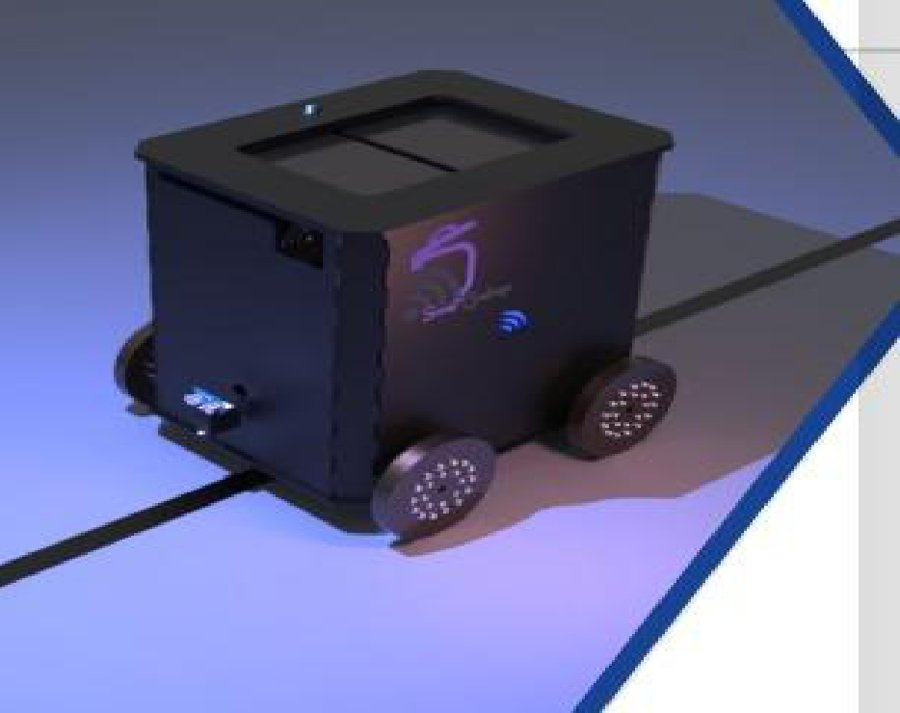

# Smart Garbage Robot with GPS (IoT)

A mobile smart bin that follows a line, avoids obstacles, opens its lid when a hand comes close, and reports its fill level and GPS position over Wi-Fi.

B.Sc. project, Mechatronics Engineering, Mansoura University (2022/2023). **Graded 1.0.** Built by an 11-person team led by Mohamed Sroor, supervised by Dr. Hesham Helmy Gad.

| Line following | Fill level in the Blynk app |
| --- | --- |
|  |  |

> **About this code.** The original source files were lost after graduation. The project handbook kept most of the code as screenshots, and this repository rebuilds it from them in 2026: same boards, pins, sensors and logic. It also fixes a few things the screenshots show: the lid no longer blocks the Wi-Fi loop for 5 s, the ultrasonic read times out instead of hanging, and the GPS page uses the local time zone. GitHub Actions compiles all three sketches on every push.

## How it works

Three controllers, one job each:

**1. Line follower with obstacle avoidance** ([`line_follower/`](line_follower/line_follower.ino), Arduino Uno). Two IR sensors keep a black line between them. When the front ultrasonic sensor sees something closer than 15 cm, the robot stops, turns the sensor right and left on a servo, and drives around the obstacle on the side with more room before turning back onto the line. The motors run through a relay module, so speed is fixed; steering is done by reversing one side.

**2. Smart lid and fill level** ([`smart_bin_esp32/`](smart_bin_esp32/smart_bin_esp32.ino), ESP32). An IR sensor at the lid detects a hand and a servo opens the lid for 5 s. An ultrasonic sensor in the lid measures the distance to the rubbish and converts it to a fill percentage (21 cm deep bin). Distance, fill level and lid angle go to a Blynk IoT dashboard every second, so the collection service can see which bins need emptying.

**3. GPS location page** ([`gps_tracker_esp8266/`](gps_tracker_esp8266/gps_tracker_esp8266.ino), NodeMCU ESP8266). Parses NMEA data from the GPS module with TinyGPS++ and serves a page in the local network with latitude, longitude, date, time and a Google Maps link. The page refreshes every 5 s.

## Hardware

| Part | Used for |
| --- | --- |
| Arduino Uno | Drive controller |
| ESP32 (ESP-32S) | Lid, fill level, Blynk |
| NodeMCU ESP8266 | GPS web server |
| u-blox NEO-M8N GPS with active antenna | Bin position |
| 2 × HC-SR04 ultrasonic sensor | Obstacle distance, fill level |
| 3 × IR obstacle sensor | Line following, hand detection |
| S3003 servos | Sensor sweep, lid doors |
| 2-channel 10 A relay module | Motor switching |
| DC gear motors, 12 V battery, 12 V to 5 V buck converter | Drive and power |

### Pins

| Board | Signal | Pin |
| --- | --- | --- |
| Uno | Left / right IR | A0 / A1 |
| Uno | Ultrasonic echo / trigger | A2 / A3 |
| Uno | Sensor servo | A5 |
| Uno | Motor relays in1 to in4 | 9, 8, 7, 6 |
| ESP32 | Hand IR | GPIO 34 |
| ESP32 | Lid servo | GPIO 13 |
| ESP32 | Ultrasonic echo / trigger | GPIO 32 / 33 |
| ESP8266 | GPS TX / RX | D2 (GPIO 4) / D1 (GPIO 5) |

## Building

Open each folder in the Arduino IDE (or use `arduino-cli`) and select the board:

| Sketch | Board | Libraries |
| --- | --- | --- |
| `line_follower` | Arduino Uno | none |
| `smart_bin_esp32` | ESP32 Dev Module | Blynk, ESP32Servo |
| `gps_tracker_esp8266` | NodeMCU 1.0 (ESP-12E) | TinyGPSPlus |

Before flashing, put your Wi-Fi name and password in the two ESP sketches, and your Blynk template ID and device token in `smart_bin_esp32`. In Blynk, create datastreams V0 (distance, cm), V1 (fill level, %) and V2 (lid angle).

## Mechanical design

Designed in SolidWorks. The first body was iron and too heavy to drive, so we rebuilt it in laser-cut wood at 32 × 41.5 × 40 cm. The wheels are made of wood too, fixed with 22 screws each. A gear mechanism opens the two lid doors with servos.

| Inside: lid gears and sensors | Assembly |
| --- | --- |
|  |  |

## Credits

Mansoura University, Faculty of Engineering, Mechatronics Engineering Program. Supervisors: Dr. Hesham Helmy Gad, Eng. Ahmed Radwan.

MIT License.
